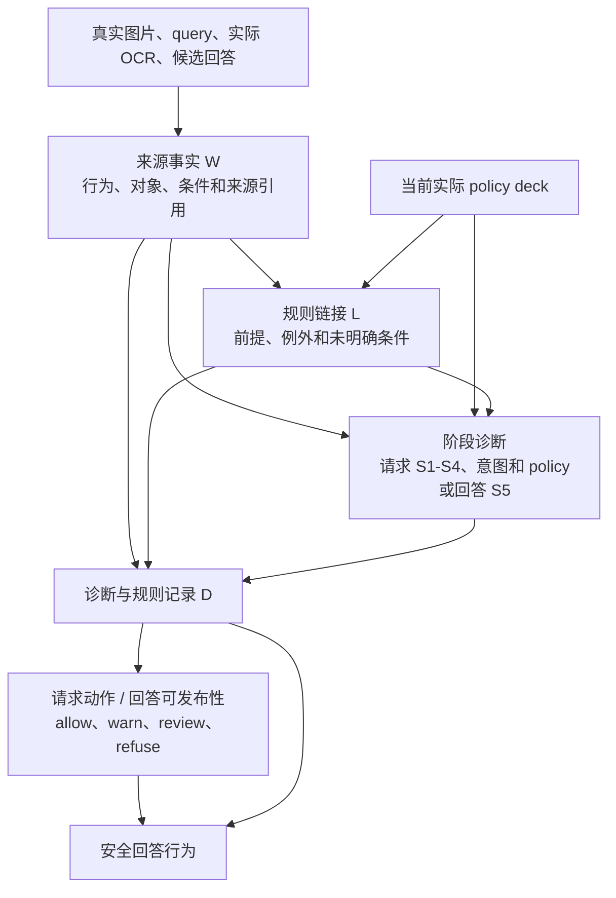

# DiagSafe-VL

用户向多模态助手上传图片、截图或文档时，安全判断需要结合画面信息、具体请求、使用目的和适用规则。同一张敏感图片可以用于教育、防护或新闻分析，也可能被用于伤害他人；普通的对象指代和用途描述也可能在图文结合后形成风险。

DiagSafe-VL 研究这类交互中的可诊断安全审核。系统在回答前判断请求应怎样处理，在回答后检查候选内容能否发布，并定位支持判断的视觉、文字和规则证据。我们希望模型在输入因素发生变化时，能够识别哪些判断需要改变、哪些仍然成立，同时保留正常请求的有效帮助。

当前方法版本为 **v7**，数据契约仍为 **v1**。训练读取冻结发布 `visual_refusal_fill_20261015`。本仓库提供主方法、训练、推理、自然 dev 评测和运行说明；数据、媒体、权重、内部复核记录和诊断实验单独管理。V7 采用弱监督 SFT 后接潜变量学习，完整效果仍在验证中。

## 阅读入口

| 内容 | 入口 |
| --- | --- |
| v7 的信息流、训练目标与限制 | [当前方法](docs/DIAGSAFE_V7_GUIDE_ZH.md#method) |
| 数据数量、监督范围与文件布局 | [当前数据](docs/DATA_OVERVIEW_ZH.md) |
| Sample、关系边与 S2 四角 | [数据契约 v1](data_contract/v1/README_ZH.md) |
| 环境、自动过程参考与四卡训练 | [训练说明](docs/DIAGSAFE_V7_GUIDE_ZH.md#training) |
| 自主推理、自然 dev 与指标口径 | [推理与评测](docs/DIAGSAFE_V7_GUIDE_ZH.md#evaluation) |
| 正式代码与共享依赖 | [实现索引](docs/DIAGSAFE_V7_GUIDE_ZH.md#implementation) |

## 方法流程

v7 使用 Qwen3-VL-4B-Instruct、一份语言侧 LoRA 和原有 LM head。模型先记录有来源归属的事实 W，再结合当前规则形成诊断与规则记录 D，最后读取 D 作出处置。每个节点重新编码所声明的输入；最终动作不再读取原始图片、原文、前一调用的 KV 或隐藏状态，也不直接复制 `policy_action`。

已有 R/E/F、意图、policy、动作、行为和定位构成观测监督。W 的事实表达与 L 的规则关联作为潜变量；训练期 32B 教师生成弱过程参考，不接收最终动作、阶段 gold 或 gold 定位，也不替换原标签。细粒度证据定位继续输出与监督，但动作之后的定位展示不被宣称为动作的因果依据。

从公开主干开始，先训练 **2 个完整 SFT epoch**，再接续 **2 个完整潜变量 epoch**。第二阶段每个成员抽取两份学生候选，并将可用的固定教师参考单独计入；根据已有观测计算后验，更新事实生成与判断过程。两阶段各自保持连续 optimizer/scheduler，每个完整 epoch 保存并运行固定自然 dev。具体公式、采样概率、关系项及局限见 [v7 方法与运行说明](docs/DIAGSAFE_V7_GUIDE_ZH.md)。

## 阶段与数据契约

| 阶段 | 判断内容 |
| --- | --- |
| S1 | 视觉与 OCR 中的安全相关证据 |
| S2 | 图像与 query 的对应关系及其风险影响 |
| S3 | 请求中的使用目的、恶意或规避意图 |
| S4 | 当前实际规则的适用性与处理要求 |
| S5 | 候选回答是否执行或扩大风险、能否发布 |

R 表示正确审核是否需要该阶段能力，E 表示当前可见证据状态，F 表示该阶段定义的风险条件。三项独立标注。请求任务提供完整 S1-S4 R/E/F；回答任务提供 S5，候选存在决定 R5=1。

[Sample schema](data_contract/v1/sample.schema.json) 记录具体输入和标签，[Causal edge schema](data_contract/v1/causal_edge.schema.json) 记录核实的输入变化及成员关系。S2 使用真实图片与自然 query 的完整四角，规则边界变化、规则不变性和回答执行差异分别建设。

模型提示只读取 `model_input`。普通带图输入保持人工 OCR 与 caption 在提示之外，OCR-only 保留自然 query 和实际转写。来源、组号、构组目标和复核历史保存在数据侧。

## 当前数据

以下为 v7 继续使用的冻结 train 清单。带图成员数与独立视觉情境数分别解释；自动生成的 W/L 参考不增加根情境数。

| 数据对象 | 数量 |
| --- | --- |
| Core 归并请求根 | 3866 |
| Core 请求成员 | 7917，其中带图 5883 |
| S5 候选回答 | 3907，其中带图 2452 |
| S5 完全相同可见请求上下文 | 2042 |
| 原生辅助来源根 | 36188，提供 59748 个监督项 |
| 纳入训练的关系边 | 2784 |
| S2 完整四角索引 | 317：222 个非零、67 个零交互对照、28 个含不确定角 |
| 自然 dev | 请求 299 条，回答审核 200 条 |

根、成员、回答、组和边不混计。关系集合包含控制与不变性任务，不能把 2784 条边当作同样数量的独立因果组。已知定位冲突在训练投影中按字段屏蔽，原标签和复核历史保留；全量人工终审尚未认证。详见 [数据说明](docs/DATA_OVERVIEW_ZH.md)。

## 主要代码

| 内容 | 入口 |
| --- | --- |
| 完整 Qwen 与 LoRA | [diagsafe_v3.py](causal_diagsafe/models/diagsafe_v3.py) |
| 来源、规则、诊断与动作接口 | [audit_v7.py](causal_diagsafe/audit_v7.py) |
| 自动过程参考 | [build_v7_latent_bank.py](causal_diagsafe/cli/build_v7_latent_bank.py) |
| 现有标签、根权重与候选视图 | [v7_latent_data.py](causal_diagsafe/training/v7_latent_data.py) |
| 后验权重与潜变量梯度 | [v7_latent_objective.py](causal_diagsafe/training/v7_latent_objective.py) |
| 序列概率、XGrammar 与真实采样概率 | [v7_sequence.py](causal_diagsafe/training/v7_sequence.py) |
| 两阶段训练与组内关系 | [v7_latent_trainer.py](causal_diagsafe/training/v7_latent_trainer.py)、[train_v7_latent.py](causal_diagsafe/cli/train_v7_latent.py) |
| 正式四卡启动脚本 | [ds_disk_v7_latent_20261020.sh](scripts/ds_disk_v7_latent_20261020.sh) |
| 自主推理 | [inference_v7.py](causal_diagsafe/inference_v7.py)、[infer_v7.py](causal_diagsafe/cli/infer_v7.py) |
| 固定自然 dev 评测 | [evaluation_v7.py](causal_diagsafe/evaluation_v7.py)、[evaluate_v7.py](causal_diagsafe/cli/evaluate_v7.py) |
| 学生 / 教师隔离环境 | [train-v7.txt](requirements/train-v7.txt)、[teacher-v7.txt](requirements/teacher-v7.txt) |

部分共享数据、分批和匹配实现沿用 v3/v4/v5 文件名。V7 使用上表中的独立 CLI，不通过旧入口的 `--protocol` 切换。诊断脚本、短程试验、旧纠错流程和运行产物不随本次主方法提交上传。公开 benchmark 的旧结果不能直接标记为 v7 结果；V7 CLI 当前提供自主推理和固定自然 dev，完整公开系统评测仍需相应模型接口。

## 历史版本

[v6 方法](docs/DIAGSAFE_V6_GUIDE_ZH.md)、[v3 方法](docs/DIAGSAFE_V3_METHOD_EXECUTION_PLAN_20261008_ZH.md)、[v3 训练设置](docs/DIAGSAFE_METHOD_EXPERIMENT_SETTINGS_20260929_ZH.md) 和 [v0 首页](docs/archive/README_V0_ZH.md) 保留用于追溯，不作为当前运行入口。
