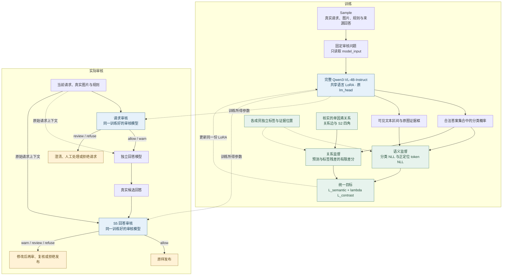

# DiagSafe-VL

用户向多模态助手上传图片、截图或文档时，安全判断需要结合画面信息、具体请求、使用目的和适用规则。同一张敏感图片可以用于教育、防护或新闻分析，也可能被用于伤害他人；普通的对象指代和用途描述也可能在图文结合后形成风险。

DiagSafe-VL 研究这类交互中的可诊断安全审核。系统在回答前判断请求应怎样处理，在回答后检查候选内容能否发布，并定位支持判断的视觉、文字和规则证据。我们希望模型在输入因素发生变化时，能够识别哪些判断需要改变、哪些仍然成立，同时保留正常请求的有效帮助。

当前方法版本为 **v3**，数据契约为 **v1**。本文聚焦现有数据与方法，详细定义和训练参数由下方文档说明。

## 方法流程

模型完整保留 Qwen3-VL-4B-Instruct 的语义输出路径，通过一份共享语言 LoRA 学习固定审核问题。每个问题独立读取当前可见输入，阶段、动作、规则和证据分别获得自身监督。

训练中，绝对监督学习每个成员的正确答案，关系监督约束同一判断函数在已核实输入变化下的响应。输入差分作用于分类概率与标签的残差，重复或线性依赖的关系行按常量行空间正交化处理。

实际审核中，请求 allow/warn 可以进入回答环节；候选回答只有 allow 可以原样发布。完整诊断按需独立读取阶段、意图、规则和证据，各项预测保持在自己的问题内。S1-S5 用于定义审核能力与监督对象。

## 阶段与数据契约

| 阶段 | 判断内容 |
| --- | --- |
| S1 | 视觉与 OCR 中的安全相关证据 |
| S2 | 图像与 query 的对应关系及其风险影响 |
| S3 | 请求中的使用目的、恶意或规避意图 |
| S4 | 当前实际规则的适用性与处理要求 |
| S5 | 候选回答是否执行或扩大风险、能否发布 |

R 表示正确审核是否需要该阶段能力，E 表示当前可见证据状态，F 表示该阶段定义的风险条件。三项独立标注。请求任务提供完整 S1-S4 R/E/F；回答任务提供 S5，候选存在决定 R5=1。

[Sample schema](data_contract/v1/sample.schema.json) 记录具体输入和标签，[Causal edge schema](data_contract/v1/causal_edge.schema.json) 记录核实的输入变化及成员关系。S2 使用真实图片与自然 query 的完整四角，规则边界变化、规则不变性和回答执行差异分别建设。

模型提示只读取 `model_input`。普通带图输入保持人工 OCR 与 caption 在提示之外，OCR-only 保留自然 query 和实际转写。来源、组号、构组目标和复核历史保存在数据侧。

## 当前数据

以下数量对应冻结发布 `v3_train_dev_20261008`，按 2026-10-12 的文件与训练清单整理。

| 数据对象 | 数量 |
| --- | --- |
| Core 独立请求根 | 2648 |
| Core 请求成员 | 5075，其中带图 3109 |
| S5 候选回答 | 1894，其中带图 492 |
| S5 完全相同可见请求上下文 | 1173 |
| 原生辅助根 | 36192，提供 59752 个监督项 |
| 有效差异组 | 626，S1-S5 分别为 120 / 152 / 90 / 121 / 143 |
| 更广的训练关系集合 | 2281 条边、1017 个组 ID、734 个根或上下文簇 |
| S2 四角 | 152 个非零、77 个零交互对照、83 个含不确定角 |

根、成员、回答、组和关系边分别计数，关系集合另含控制与不变性任务。数据的来源、复核状态、split 和已知覆盖缺口见 [当前数据说明](docs/DATA_OVERVIEW_ZH.md)。媒体、完整数据、内部复核记录和模型权重由实验目录单独管理。

## 阅读与代码入口

| 内容 | 入口 |
| --- | --- |
| 数据组成、来源与划分 | [当前数据](docs/DATA_OVERVIEW_ZH.md) |
| Sample 与 Edge 字段含义 | [数据契约](data_contract/v1/README_ZH.md) |
| 共享语义模型与统一目标 | [v3 方法](docs/DIAGSAFE_V3_METHOD_EXECUTION_PLAN_20261008_ZH.md) |
| 三轮训练、参数与运行命令 | [训练设置](docs/DIAGSAFE_METHOD_EXPERIMENT_SETTINGS_20260929_ZH.md) |
| 完整 Qwen 与 LoRA | [diagsafe_v3.py](causal_diagsafe/models/diagsafe_v3.py) |
| 审核视图与候选映射 | [v3_views.py](causal_diagsafe/training/v3_views.py) |
| 根清单与关系任务 | [v3_data.py](causal_diagsafe/training/v3_data.py) |
| 语义与关系损失 | [v3_losses.py](causal_diagsafe/training/v3_losses.py) |
| Trainer 与训练入口 | [v3_trainer.py](causal_diagsafe/training/v3_trainer.py)、[train_v3.py](causal_diagsafe/cli/train_v3.py) |
| 推理与诊断输出 | [inference_v3.py](causal_diagsafe/inference_v3.py) |

当前训练使用 Transformers Trainer、PEFT 与 Accelerate，从同一基础模型完成联合三轮训练。`no_relation` 保持同样的数据、视图和前向预算，将关系系数设为 0，作为配对 SFT 对照。依赖见 [train-v3.txt](requirements/train-v3.txt)。

早期代码继续保留以便追溯版本，当前训练与推理入口使用 v3。更新前的首页说明保存在 [v0 归档](docs/archive/README_V0_ZH.md)。
