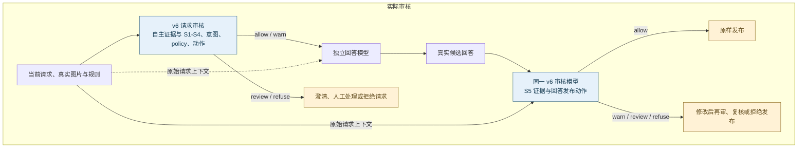

# DiagSafe-VL

用户向多模态助手上传图片、截图或文档时，安全判断需要结合画面信息、具体请求、使用目的和适用规则。同一张敏感图片可以用于教育、防护或新闻分析，也可能被用于伤害他人；普通的对象指代和用途描述也可能在图文结合后形成风险。

DiagSafe-VL 研究这类交互中的可诊断安全审核。系统在回答前判断请求应怎样处理，在回答后检查候选内容能否发布，并定位支持判断的视觉、文字和规则证据。我们希望模型在输入因素发生变化时，能够识别哪些判断需要改变、哪些仍然成立，同时保留正常请求的有效帮助。

当前方法版本为 **v6**，数据契约仍为 **v1**。训练读取冻结发布 `visual_refusal_fill_20261015`。本仓库提供正式方法实现和运行说明；完整数据、媒体、模型权重、内部复核记录和机制探索产物单独管理。方法实现已同步，不据此宣称最终模型效果已经验证。

## 阅读入口

| 内容 | 入口 |
| --- | --- |
| v6 的信息流、训练目标与限制 | [当前方法](docs/DIAGSAFE_V6_GUIDE_ZH.md#method) |
| 数据数量、监督范围与文件布局 | [当前数据](docs/DATA_OVERVIEW_ZH.md) |
| Sample、关系边与 S2 四角 | [数据契约 v1](data_contract/v1/README_ZH.md) |
| 环境与四卡三轮训练 | [训练说明](docs/DIAGSAFE_V6_GUIDE_ZH.md#training) |
| 完整诊断推理、dev 与公开评测 | [推理与评测](docs/DIAGSAFE_V6_GUIDE_ZH.md#evaluation) |
| 正式代码与共享依赖 | [实现索引](docs/DIAGSAFE_V6_GUIDE_ZH.md#implementation) |

## 方法流程

v6 使用完整 Qwen3-VL-4B-Instruct、一份语言侧 LoRA 和原有 LM head。模型沿固定审核顺序生成证据、读取阶段与动作；原始输入始终可见。分类答案对外保存，在后续模型上下文中的位置统一替换为固定占位符，避免前一个类别文本直接成为后一个判断的依据。

训练时，每个成员在每轮首次使用时由当前模型生成证据，并在该轮内重用。分类与关系损失读取这些自主证据；人工证据通过单独前向监督定位，不把 gold 证据前缀提供给分类损失。已核实关系采用固定标签计数下的组内条件匹配，保留单条监督来学习绝对边界。

从公开主干连续训练 **3 个完整 epoch**，optimizer 和 scheduler 不按轮重启。每轮用完整自然 dev 选择 checkpoint；中间快照只用于恢复。具体目标、类别测度和选择口径见 [v6 方法与运行说明](docs/DIAGSAFE_V6_GUIDE_ZH.md)。

## 阶段与数据契约

| 阶段 | 判断内容 |
| --- | --- |
| S1 | 视觉与 OCR 中的安全相关证据 |
| S2 | 图像与 query 的对应关系及其风险影响 |
| S3 | 请求中的使用目的、恶意或规避意图 |
| S4 | 当前实际规则的适用性与处理要求 |
| S5 | 候选回答是否执行或扩大风险、能否发布 |

R 表示正确审核是否需要该阶段能力，E 表示当前可见证据状态，F 表示该阶段定义的风险条件。三项独立标注。请求任务提供完整 S1-S4 R/E/F；回答任务提供 S5，候选存在决定 R5=1。

[Sample schema](data_contract/v1/sample.schema.json) 记录具体输入和标签，[Causal edge schema](data_contract/v1/causal_edge.schema.json) 记录核实的输入变化及成员关系。S2 使用真实图片与自然 query 的完整四角，规则边界变化、规则不变性和回答执行差异分别建设。

模型提示只读取 `model_input`。普通带图输入保持人工 OCR 与 caption 在提示之外，OCR-only 保留自然 query 和实际转写。来源、组号、构组目标和复核历史保存在数据侧。

## 当前数据

以下为 v6 使用的冻结 train 清单，按 2026-10-16 的方法记录整理。带图成员数与独立视觉情境数分别解释。

| 数据对象 | 数量 |
| --- | --- |
| Core 归并请求根 | 3866 |
| Core 请求成员 | 7917，其中带图 5883 |
| S5 候选回答 | 3907，其中带图 2452 |
| S5 完全相同可见请求上下文 | 2042 |
| 原生辅助来源根 | 36188，提供 59748 个监督项 |
| 纳入训练的关系边 | 2784 |
| 关系实验对象 / 根或上下文簇 | 1434 / 1012 |
| S2 完整四角索引 | 317：222 个非零、67 个零交互对照、28 个含不确定角 |
| 自然 dev | 请求 299 条，回答审核 200 条 |

根、成员、回答、组和边不混计。关系集合包含控制与不变性任务，不能把 2784 条边当作同样数量的独立因果组。已知定位冲突在训练投影中按字段屏蔽，原标签和复核历史保留；全量人工终审尚未认证。详见 [数据说明](docs/DATA_OVERVIEW_ZH.md)。

## 主要代码

| 内容 | 入口 |
| --- | --- |
| 完整 Qwen 与 LoRA | [diagsafe_v3.py](causal_diagsafe/models/diagsafe_v3.py) |
| v6 协议与字段上下文 | [audit_v6.py](causal_diagsafe/audit_v6.py)、[v6_sequence.py](causal_diagsafe/training/v6_sequence.py) |
| 紧凑 JSON 证据解码 | [audit_constraints.py](causal_diagsafe/audit_constraints.py) |
| 分类、证据与关系目标 | [v6_trainer.py](causal_diagsafe/training/v6_trainer.py)、[v5_matching.py](causal_diagsafe/training/v5_matching.py) |
| 根权重下的类别测度 | [v6_supervision.py](causal_diagsafe/training/v6_supervision.py) |
| 多轮训练与四卡取证 | [v6_formal.py](causal_diagsafe/training/v6_formal.py)、[train_v6.py](causal_diagsafe/cli/train_v6.py) |
| 正式四卡启动脚本 | [ds_disk_grounded_v6.sh](scripts/ds_disk_grounded_v6.sh) |
| 推理与诊断输出 | [inference_v6.py](causal_diagsafe/inference_v6.py)、[infer_v4.py](causal_diagsafe/cli/infer_v4.py) |
| dev / 公开 benchmark | [evaluate_v4.py](causal_diagsafe/cli/evaluate_v4.py)、[evaluate_public_v4.py](causal_diagsafe/cli/evaluate_public_v4.py) |
| 训练与 dev 依赖 | [train-v6.txt](requirements/train-v6.txt) |

部分共享实现沿用 v3/v4/v5 文件名。**v6 推理和评测必须显式传入 `--protocol v6`**，这些共用 CLI 的默认值仍是 v4。不要仅凭文件名选择协议。

## 历史版本

[v3 方法](docs/DIAGSAFE_V3_METHOD_EXECUTION_PLAN_20261008_ZH.md)、[v3 训练设置](docs/DIAGSAFE_METHOD_EXPERIMENT_SETTINGS_20260929_ZH.md) 和 [v0 首页](docs/archive/README_V0_ZH.md) 保留用于追溯，不作为当前运行入口。
